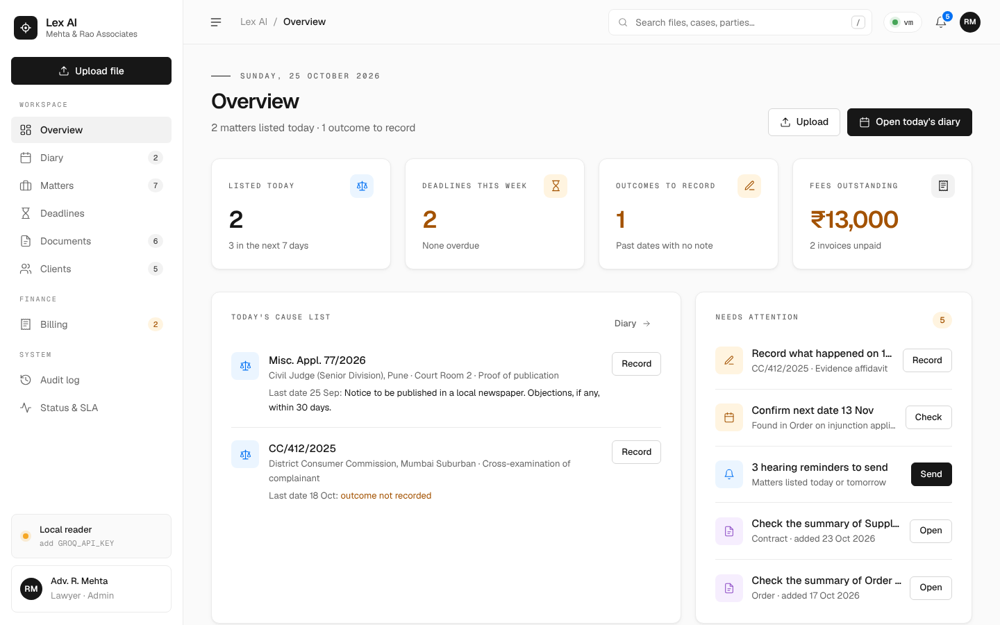
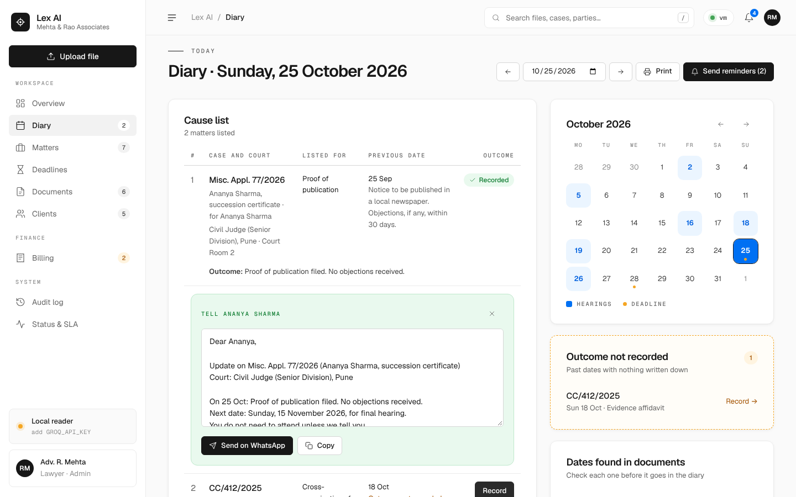
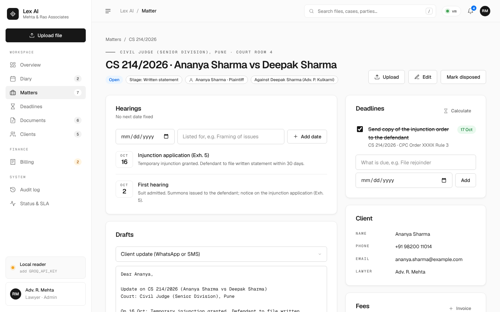
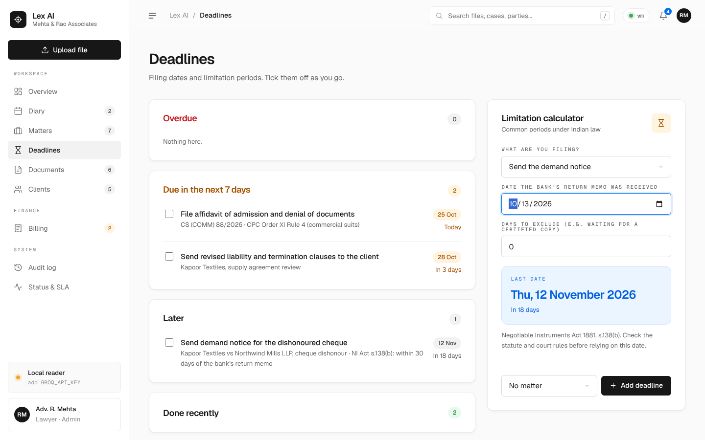
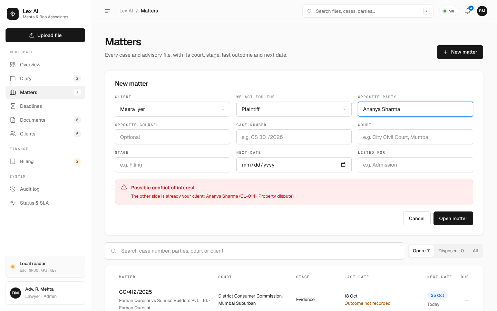
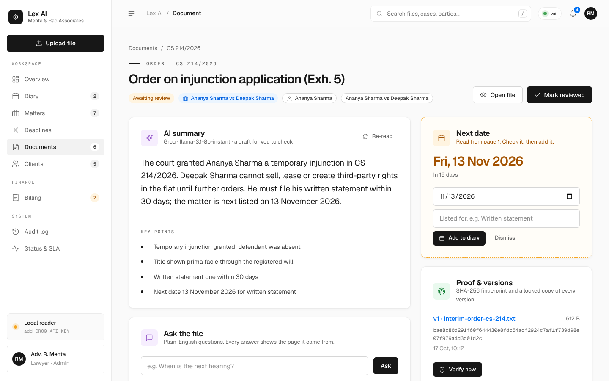
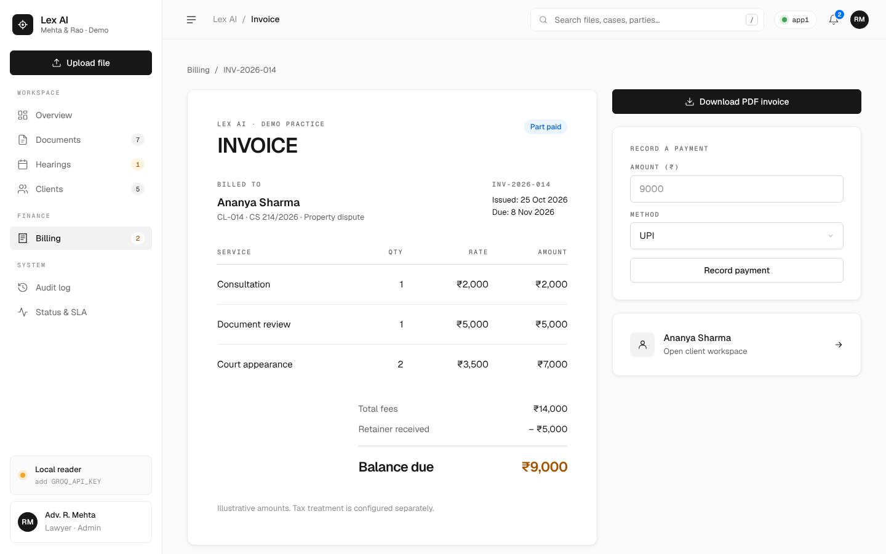
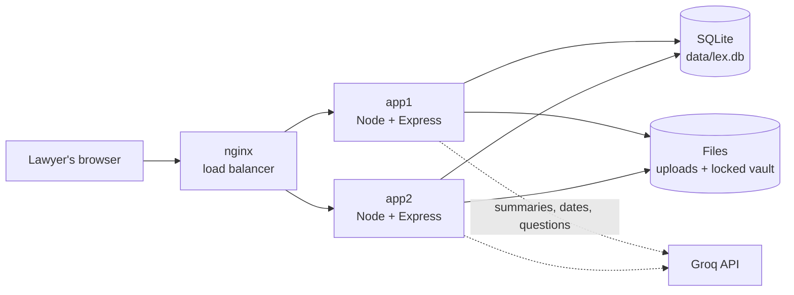
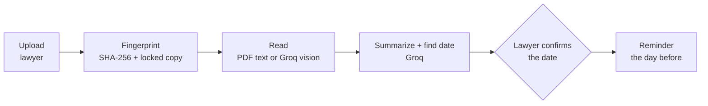
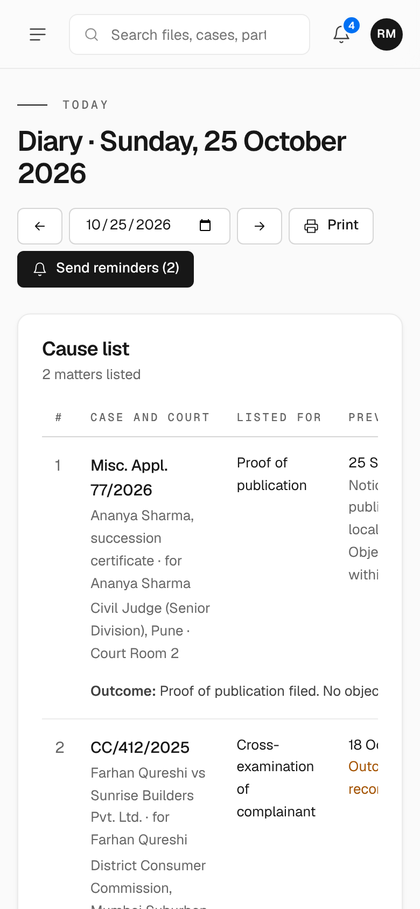

<div align="center">

# Lex AI

**Legal files, off paper and into the cloud.**

A case diary and document vault for small law practices. See what is listed today, record what happened
and the next date, tell the client on WhatsApp, track limitation deadlines, and keep every order safe,
summarized and searchable.


*Cloud Computing course project · 2026 · all data in the app is dummy data*



</div>

---

## Contents

- [About](#about)
- [The problem](#the-problem)
- [What Lex AI does](#what-lex-ai-does)
- [Quick start](#quick-start)
- [Configuration](#configuration)
- [Demo script](#demo-script-5-minutes)
- [How it works](#how-it-works)
- [Design and color coding](#design-and-color-coding)
- [Keeping compute low](#keeping-compute-low)
- [API reference](#api-reference)
- [Project structure](#project-structure)
- [Troubleshooting](#troubleshooting)
- [Team](#team)

## About

Lex AI is our five-person project for the 2026 Cloud Computing course. It shows how a small law practice can move client files off paper and into the cloud: AI reads each file, and a lawyer always makes the final call. It is an MVP built for the class presentation: every feature works end to end on made-up data, and it runs cheaply on one small server.

📽️ **Pitch deck:** [`docs/pitch-deck.html`](docs/pitch-deck.html), our 14-slide presentation. Download it and open it in a browser; use the arrow keys to move between slides.

## The problem

Most small practices still run on phones, paper and diaries:

- Client documents arrive on WhatsApp, email and pen drives, and originals get lost or damaged.
- Finding one order means flipping through hundreds of pages, and long judgments are read just for the key points.
- Hearing dates and outcomes live in a paper diary, so dates get missed and clients are not told.
- Limitation periods are worked out by hand, and routine drafts are typed from scratch every time.
- There is no backup, no audit trail, and confidential files sit on personal phones.

**The gap:** client files have no single safe home, and nothing reminds anyone of a hearing.

## What Lex AI does

**For the lawyer's day**

| | Feature | How |
| --- | --- | --- |
| 📅 | **Diary and cause list** | Every matter listed on a day, with the court, what it is listed for and what happened on the previous date. Print it for court |
| ✍️ | **Record the outcome** | After court, write what happened and the next date in one form. The next date goes straight into the diary |
| 💬 | **Tell the client** | A ready-made update with the outcome and next date. Send it on WhatsApp in one tap, or copy it |
| 🗂️ | **Matters** | One workspace per case: court, stage, parties, full hearing history, documents, deadlines, fees and activity |
| ⚖️ | **Conflict check** | While opening a matter, Lex AI warns if the other side is already your client, or your client is an opposite party elsewhere |
| ⏳ | **Deadlines and limitation** | A calculator for common periods (CPC appeals, written statements, NI Act s.138, arbitration s.34, consumer complaints) with the section cited. Add the result as a deadline |
| 📝 | **Drafts** | Client update, adjournment application, s.138 demand notice and file note, filled in from the matter |
| 🔔 | **Reminders** | Hearings today and tomorrow, with outcomes not yet recorded flagged on the overview |

**For the files**

| | Feature | How |
| --- | --- | --- |
| 📤 | **Upload** | PDF, text and photos up to 20 MB, filed under a matter |
| ✨ | **AI summary and next date** | Groq writes a 3-sentence summary, finds the case number and parties, and reads the next date with its page. The lawyer checks it before it goes in the diary |
| 💬 | **Ask the file** | Plain-English questions. Every answer cites the page it came from |
| 🔏 | **Proof** | SHA-256 fingerprint and a read-only locked copy of every version. *Verify* and *Restore* show tamper detection live |
| 🔎 | **Search** | By case number, party, client, date or any word inside a document |
| 🧾 | **Billing** | Itemized invoices, retainers, payments and a printable PDF invoice |
| 🧭 | **Audit log and SLA** | Every action with who did it, plus live latency, error rate and health checks |

<table>
<tr>
<td width="50%"><br><sub><b>Diary.</b> Today's cause list. An outcome was just recorded and the client update is ready for WhatsApp.</sub></td>
<td width="50%"><br><sub><b>Matter.</b> Hearing history, drafts, deadlines, client and fees in one place.</sub></td>
</tr>
<tr>
<td width="50%"><br><sub><b>Deadlines.</b> Grouped by urgency, with the limitation calculator citing the section.</sub></td>
<td width="50%"><br><sub><b>Conflict check.</b> Opening a matter against an existing client is flagged.</sub></td>
</tr>
<tr>
<td width="50%"><br><sub><b>Document.</b> AI summary, and the next date read from page 1 waiting to be checked.</sub></td>
<td width="50%"><br><sub><b>Billing.</b> Itemized invoice with retainer, payments and a print-to-PDF button.</sub></td>
</tr>
</table>

## Quick start

You need **Node.js 22** (22.13 or newer). A Groq API key is optional: without one, a local reader takes over and the demo still works.

```bash
git clone https://github.com/akashdeep070/C023.git lex-ai && cd lex-ai
npm install
cp .env.example .env        # optional: paste your GROQ_API_KEY
npm run dev
```

Open **http://localhost:5173**. Vite serves the React app with hot reload and forwards `/api` to the Express server on port 3000.
On first run the app creates `data/` and fills it with demo clients, documents and invoices.

### Production build

```bash
npm run build               # compile the server, type-check and build the React app
npm start                   # one server on http://localhost:3000 serves the API and the app
```

### Docker, as on the architecture slide

```bash
cp .env.example .env
docker compose up --build   # http://localhost
```

This runs **nginx** in front of two identical app containers, **app1** and **app2**, sharing one data volume.
If one container stops, nginx sends traffic to the other and Docker restarts the stopped one.

### Deploy on Vercel

The repo is ready for Vercel: the React app is served from Vercel's CDN, and the API runs as one serverless function ([`api/index.js`](api/index.js), configured in [`vercel.json`](vercel.json)).

1. Go to [vercel.com/new](https://vercel.com/new) and import the GitHub repo **akashdeep070/C023**.
2. Set **Project Name** to **`lex-ai-legal-vault`**. The app will live at `https://lex-ai-legal-vault.vercel.app`, if that name is free.
3. Leave the build settings as they are; `vercel.json` sets them.
4. Optional: under **Environment Variables**, add `GROQ_API_KEY`.
5. Click **Deploy**.

If the code is not on the repo's default branch, set **Settings → Git → Production Branch** to the branch that has it, or merge it first.

Or from a terminal: `npx vercel --prod`, and choose `lex-ai-legal-vault` as the project name when asked.

**What changes on Vercel:**

| | Local / Docker | Vercel |
| --- | --- | --- |
| Data | Kept in `data/` | Kept in `/tmp` only while the function stays warm. A cold start brings back fresh demo data |
| Upload size | 20 MB | 4 MB (Vercel caps a function request at 4.5 MB) |
| "Served by" | `app1` / `app2` | The Vercel region, for example `vercel-bom1` |

That is fine for a class demo. For data that must last, use the Docker setup, as on the architecture slide.

### Scripts

| Command | What it does |
| --- | --- |
| `npm run dev` | API (tsx watch) and web (Vite) together |
| `npm run build` | Compile the server to `dist/server`, type-check the client, build it to `dist/client` |
| `npm start` | Run the built server, which also serves the React app |
| `npm run typecheck` | Type-check the server and the client |

## Configuration

Set these in `.env` or the environment. All of them are optional.

| Variable | Default | Purpose |
| --- | --- | --- |
| `GROQ_API_KEY` | *(empty)* | Turns on Groq. Get a free key at [console.groq.com/keys](https://console.groq.com/keys) |
| `GROQ_MODEL` | `llama-3.1-8b-instant` | Text model for summaries, dates and Q&A |
| `GROQ_VISION_MODEL` | `meta-llama/llama-4-scout-17b-16e-instruct` | Reads text from photos and scans |
| `PORT` | `3000` | API port |
| `DATA_DIR` | `./data` | Where the database, files and locked copies live |
| `INSTANCE_NAME` | host name | Name shown as "Served by" (`app1`, `app2` in Docker) |
| `SEED_DEMO` | `1` | Fill an empty database with demo data. Set `0` to start empty |

If Groq retires a model, change `GROQ_MODEL` or `GROQ_VISION_MODEL`. No code changes are needed.

## Demo script (5 minutes)

1. **Overview.** Two matters are listed today, one past date has no outcome, and an affidavit is due today.
2. **Diary.** Click **Record** on *Misc. Appl. 77/2026*, write what happened, pick a next date and save. The client update appears: click **Send on WhatsApp**.
3. **Outcome not recorded.** In the side panel, open *CC/412/2025* and record the missed outcome.
4. **Document.** Open *Order on injunction application (Exh. 5)*. The AI read the next date from page 1. Check it, then **Add to diary**.
5. **New matter.** Go to **Matters → New matter**, pick a client and type *Ananya Sharma* as the opposite party. The conflict check flags her as an existing client.
6. **Deadlines.** In the calculator, choose *Cheque dishonour → Send the demand notice*, set the return-memo date, and **Add deadline**. Then open the Kapoor matter and draft the s.138 notice.
7. **Upload and ask.** Upload `samples/sample-bail-order.pdf` and ask "When was bail granted?". The answer cites page 3.
8. **Proof.** On a document, **Verify now**, then **Demo: simulate a tampering script**, **Verify now** (red) and **Restore locked copy** (green).
9. **Break it on purpose (Docker).** `docker compose exec app1 kill 1`. The app keeps working through app2.

Another sample, `legal-notice-kapoor.txt`, is in [`samples/`](samples).

## How it works

### Request flow



### What happens after one upload



The AI only suggests. Nothing reaches a reminder until a person confirms the date, and every AI answer shows its page.

### How it maps to AWS

The demo runs anywhere with Node. Each local piece stands in for an AWS service from the architecture slide:

| In this app | On AWS |
| --- | --- |
| `data/uploads/` working copy | S3 bucket with versioning |
| `data/vault/` read-only copy | S3 Object Lock |
| `data/lex.db` (SQLite) | DynamoDB |
| Audit table | CloudTrail + app log |
| *Send reminders* | EventBridge Scheduler + SNS email or WhatsApp Business API |
| `GET /health` | Route 53 health check, CloudWatch |
| nginx + app1 + app2 (Docker Compose) | One EC2 t3.micro running Docker Compose |
| Groq | Textract + Bedrock |

## Design and color coding

The interface is hand-written CSS with no UI framework. It follows Vercel's **Geist** design language: Geist and Geist Mono fonts, the Geist gray scale, black primary buttons and a blue focus ring. The layout is a SaaS control panel with a sidebar menu that collapses to an icon rail (☰), or slides in as a drawer on phones.

Grays carry the layout. Color is only used to mean something:

| Color | Means | Where you see it |
| --- | --- | --- |
| 🟢 Green | Done or healthy | Reviewed files, paid invoices, verified fingerprints, met SLAs, healthy checks |
| 🟠 Amber | Needs a person | Outcomes not recorded, deadlines this week, AI-read dates to check, summaries to review, money owed |
| 🔴 Red | Error or risk | Overdue deadlines, conflicts of interest, tampering, overdue invoices, missed SLAs |
| 🔵 Blue | Scheduled, links and focus | Hearings in the diary, next dates, uploads, reminders, the hearings chart |
| 🟣 Purple | AI | Summaries, *Ask the file* answers, AI steps in the pipeline |

Every color is paired with a text label, so nothing relies on color alone. Badge text uses the darker shade of each color and passes WCAG AA contrast.

<p align="center"></p>

## Keeping compute low

| Choice | Effect |
| --- | --- |
| `llama-3.1-8b-instant` for text | Small, fast and cheap. The vision model is only used for photos |
| At most ~9,000 characters per prompt | *Ask the file* sends only the 3 most relevant pages |
| Output capped at 200–450 tokens | Short answers, predictable cost |
| AI runs once per upload | Page views never call the AI |
| First 60 PDF pages only | Bounded extraction time |
| Node's built-in `node:sqlite` | No database server and no native modules to compile |
| One Node process per container | About 80 MB of memory each, so two fit on a t3.micro |
| No UI framework | The React bundle is about 100 KB gzipped |

## API reference

All endpoints return JSON. Errors come back as `{ "error": "message" }` with a 4xx or 5xx status.

<details>
<summary><b>Documents</b></summary>

| Method | Path | Does |
| --- | --- | --- |
| `GET` | `/api/documents?q=&type=` | Search documents |
| `POST` | `/api/documents` | Upload (multipart: `file`, `title`, `matter_id`, or `client_id`/`new_client` and `case_number`, `doc_type`) |
| `GET` | `/api/documents/:id` | Document, versions, extracted pages, key points and activity |
| `GET` | `/api/documents/:id/file/:version` | Open the file (`?dl=1` to download) |
| `POST` | `/api/documents/:id/version` | Upload a new version (multipart `file`) |
| `POST` | `/api/documents/:id/reanalyze` | Run the AI summary again |
| `POST` | `/api/documents/:id/review` | Mark the summary as reviewed |
| `POST` | `/api/documents/:id/hearing` | `{ "action": "confirm", "date", "purpose" }` adds the date to the matter's diary; `{ "action": "clear" }` dismisses it |
| `POST` | `/api/documents/:id/ask` | `{ "question": "..." }` → `{ answer, page, source, ms }` |
| `POST` | `/api/documents/:id/verify` | Re-hash every version |
| `POST` | `/api/documents/:id/tamper` | Demo only: alter the working copy |
| `POST` | `/api/documents/:id/restore` | Restore changed versions from the locked copy |

</details>

<details>
<summary><b>Case diary</b></summary>

| Method | Path | Does |
| --- | --- | --- |
| `GET` | `/api/diary?date=&month=` | Cause list for a day, deadlines due, dates to check, outcomes not recorded, calendar marks |
| `POST` | `/api/hearings/:id/outcome` | `{ outcome, notes, stage, next_date, next_purpose, disposed }` |
| `POST` | `/api/hearings/:id/delete` | Remove a future date that has no outcome |
| `POST` | `/api/hearings/remind` | Send reminders for hearings today and tomorrow |
| `GET` | `/api/matters?q=&status=` | Matters with next date, last outcome and open deadlines |
| `POST` | `/api/matters` | `{ client_id or new_client, case_number, court, our_side, opposite_party, opposite_counsel, stage, next_date, next_purpose }` |
| `GET` | `/api/matters/:id` | Matter, client, hearings, documents, deadlines, invoices and activity |
| `POST` | `/api/matters/:id` | Update details or `{ status: "Disposed" }` |
| `POST` | `/api/matters/:id/hearings` | `{ date, purpose }` |
| `GET` | `/api/conflicts?party=&client=` | Conflict-of-interest matches |
| `GET` | `/api/deadlines` | Open and recently done deadlines |
| `POST` | `/api/deadlines` | `{ title, due, rule, matter_id }` |
| `POST` | `/api/deadlines/:id/done` | `{ done: true or false }` |

</details>

<details>
<summary><b>Clients and billing</b></summary>

| Method | Path | Does |
| --- | --- | --- |
| `GET` | `/api/clients?q=` | Client directory with matters, next hearing and balance |
| `POST` | `/api/clients` | `{ name, matter, lawyer, email, phone }` |
| `GET` | `/api/clients/:id` | Profile, matters, documents, invoices and timeline |
| `GET` | `/api/invoices` | Invoices with totals |
| `POST` | `/api/invoices` | `{ client_id, case_number, issued, due, retainer, lines: [{ service, qty, rate }] }` |
| `GET` | `/api/invoices/:id` | Invoice with lines and payments |
| `POST` | `/api/invoices/:id/payments` | `{ amount, method }` |

</details>

<details>
<summary><b>System</b></summary>

| Method | Path | Does |
| --- | --- | --- |
| `GET` | `/health` | `200` when the database and storage are fine, `503` otherwise. For load balancer health checks |
| `GET` | `/api/status` | Uptime, request count, average/P95/P99 latency, error rate, checks, AI model |
| `GET` | `/api/dashboard` | Everything the overview page shows |
| `GET` | `/api/meta` | Instance name, AI status and sidebar counts |
| `GET` | `/api/activity` | The latest 200 audit entries |
| `GET` | `/api/upload-options` | Clients and document types for forms |

</details>

## Project structure

```
server/                 Express API (TypeScript)
  app.ts                App setup, documents, clients, billing and the overview
  diary.ts              Matters, hearings, outcomes, deadlines, reminders and the conflict check
  index.ts              Serves the app on a port (local and Docker)
  http.ts               Small request helpers
  ai.ts                 Groq calls (summary, hearing date, Q&A, image reading) and the local fallback
  extract.ts            Text from PDFs (unpdf), text files and images
  vault.ts              Storage, SHA-256, versions, tamper and restore, audit log
  queries.ts            Shared read queries, request metrics and health
  db.ts                 SQLite schema and helpers (node:sqlite)
  seed.ts               Sample clients, matters, hearings, deadlines, documents and invoices
shared/                 Used by both server and client
  types.ts              API response types
  format.ts             Dates, rupees (₹3,40,000) and file sizes
  limitation.ts         Limitation periods with their sections, and the date calculation
  drafts.ts             Draft templates and the WhatsApp link
client/                 React app (TypeScript + Vite)
  src/main.tsx          Routes
  src/pages/            One component per page
  src/components/       Sidebar layout, outcome form, client update, drafts, calendar, chart, icons
  src/styles.css        The whole design system in one hand-written file
samples/                Files to upload during the demo
docs/screenshots/       Images used in this README
api/index.js            Vercel serverless entry that runs the same Express app
vercel.json             Vercel build settings and rewrites
Dockerfile              Two-stage build, slim Node runtime
docker-compose.yml      nginx + app1 + app2 on one shared volume
nginx.conf              Load balancing with failover
```

## Troubleshooting

| Problem | Fix |
| --- | --- |
| `node:sqlite` not found | Use Node.js 22.13 or newer (`node -v`) |
| Sidebar says **Local reader** | No `GROQ_API_KEY` is set, or Groq is unreachable. The app keeps working with keyword and date matching |
| A PDF shows "no text layer" | It is a scanned image. Upload the pages as photos so the vision model can read them |
| Port 3000 or 5173 is busy | `PORT=3001 npm start`, or stop the other process |
| Want fresh demo data | Stop the app and delete the `data/` folder. Sample dates are relative to today |
| Proxy errors right after `npm run dev` | The API is still seeding demo data. Wait a second and refresh |
| Uploads vanished on Vercel | Vercel's `/tmp` storage resets when a function cold-starts. Use Docker for data that lasts |
| "Files must be 4 MB or smaller" on Vercel | Vercel's request size limit. Compress the PDF or run locally or with Docker |

## Team

| Role | Name |
| --- | --- |
| Team member | *Member name* |
| Team member | *Member name* |
| Team member | *Member name* |
| Team member | *Member name* |
| Team member | *Member name* |

---

<sub>Lex AI is a class project. Every name, case number and amount in the app is fictional. AI output is a draft that a lawyer confirms. Do not upload real client documents.</sub>
