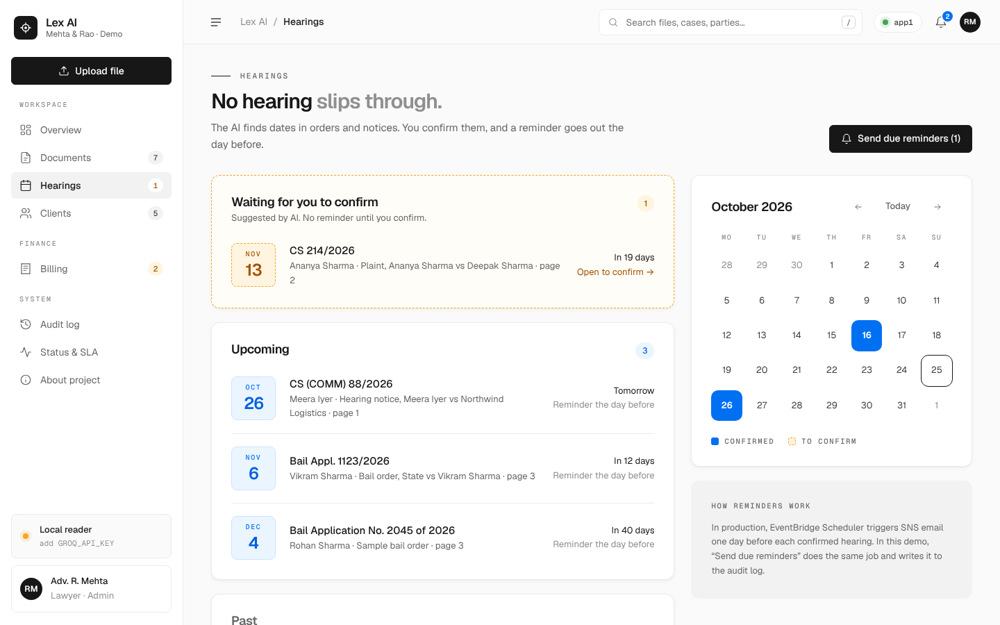
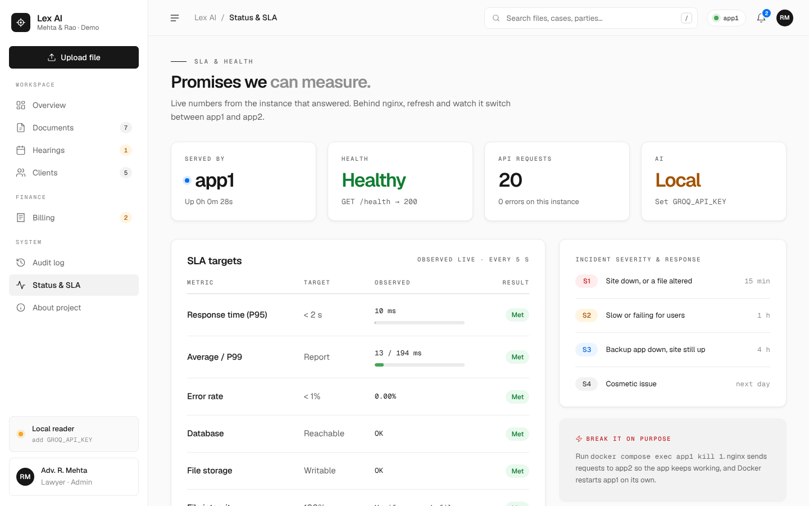
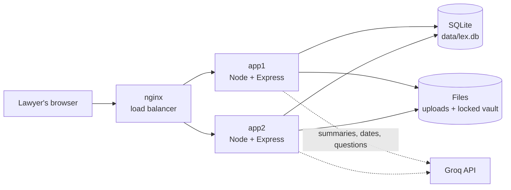
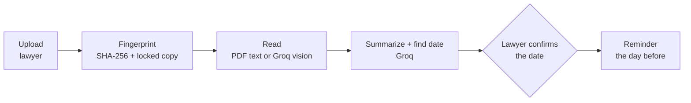

<div align="center">

# Lex AI

**Legal files, off paper and into the cloud.**

A small cloud vault for law practices. Upload a scan, photo or PDF and Lex AI fingerprints it,
keeps a locked copy, writes a short AI summary, finds the next hearing date and reminds the lawyer the day before.


*Cloud Computing course project · 2026 · all data in the app is dummy data*


</div>

---

## Contents

- [About](#about)
- [The problem](#the-problem)
- [What Lex AI does](#what-lex-ai-does)
- [Quick start](#quick-start)
- [Configuration](#configuration)
- [Demo script](#demo-script-5-minutes)
- [How it works](#how-it-works)
- [Design and color coding](#design-and-color-coding)
- [Keeping compute low](#keeping-compute-low)
- [API reference](#api-reference)
- [Project structure](#project-structure)
- [Troubleshooting](#troubleshooting)
- [Team](#team)

## About

Lex AI is our five-person project for the 2026 Cloud Computing course. It shows how a small law practice can move client files off paper and into the cloud: AI reads each file, and a lawyer always makes the final call. It is a working demo with made-up data, built to run cheaply on one small server.

📽️ **Pitch deck:** [`docs/pitch-deck.html`](docs/pitch-deck.html), our 14-slide presentation. Download it and open it in a browser; use the arrow keys to move between slides.

## The problem

Most small practices still run on phones, paper and diaries:

- Client documents arrive on WhatsApp, email and pen drives, and originals get lost or damaged.
- Finding one order means flipping through hundreds of pages, and long judgments are read just for the key points.
- Hearing dates live in a paper diary, so hearings get missed.
- There is no backup, no audit trail, and confidential files sit on personal phones.

**The gap:** client files have no single safe home, and nothing reminds anyone of a hearing.

## What Lex AI does

| | Feature | How |
| --- | --- | --- |
| 📤 | **One upload page** | PDF, text and photos (PNG, JPG, WEBP) up to 20 MB, with drag and drop |
| 🔏 | **Proof** | Every version gets a SHA-256 fingerprint and a read-only locked copy. *Verify* re-hashes the file; *Restore* brings back the locked copy |
| ✨ | **AI summary** | A small Groq model writes a 3-sentence summary and key points, and detects the case number, parties and document type |
| 📅 | **Hearing dates** | The AI finds the next hearing date and its page. The lawyer confirms it, and a reminder goes out the day before |
| 💬 | **Ask the file** | Plain-English questions. Every answer cites the page it came from |
| 🔎 | **Find in seconds** | Search by case number, party, client, date or any word inside a document |
| 👥 | **Client workspace** | Profiles, matters, documents, invoices and a case activity timeline per client |
| 🧾 | **Billing** | Itemized invoices, retainers, payments, balances and a printable PDF invoice |
| 🧭 | **Audit log** | Every upload, view, AI run, confirmation, reminder and integrity check, with who did it |
| 📈 | **Status & SLA** | Live P95/P99 latency, error rate, health checks, and which container answered |

<table>
<tr>
<td width="50%"><br><sub><b>Document.</b> AI summary, a confirmed hearing and the tamper demo catching a changed file.</sub></td>
<td width="50%"><br><sub><b>Hearings.</b> AI suggestions to confirm (amber), confirmed hearings (blue) and a calendar.</sub></td>
</tr>
<tr>
<td width="50%"><br><sub><b>Billing.</b> Itemized invoice with retainer, payments and a print-to-PDF button.</sub></td>
<td width="50%"><br><sub><b>Status & SLA.</b> Live numbers from the instance that answered, refreshed every 5 seconds.</sub></td>
</tr>
</table>

## Quick start

You need **Node.js 22.13 or newer**. A Groq API key is optional: without one, a local reader takes over and the demo still works.

```bash
git clone https://github.com/akashdeep070/C023.git lex-ai && cd lex-ai
npm install
cp .env.example .env        # optional: paste your GROQ_API_KEY
npm run dev
```

Open **http://localhost:5173**. Vite serves the React app with hot reload and forwards `/api` to the Express server on port 3000.
On first run the app creates `data/` and fills it with demo clients, documents and invoices.

### Production build

```bash
npm run build               # compile the server, type-check and build the React app
npm start                   # one server on http://localhost:3000 serves the API and the app
```

### Docker, as on the architecture slide

```bash
cp .env.example .env
docker compose up --build   # http://localhost
```

This runs **nginx** in front of two identical app containers, **app1** and **app2**, sharing one data volume.
If one container stops, nginx sends traffic to the other and Docker restarts the stopped one.

### Scripts

| Command | What it does |
| --- | --- |
| `npm run dev` | API (tsx watch) and web (Vite) together |
| `npm run build` | Compile the server to `dist/server`, type-check the client, build it to `dist/client` |
| `npm start` | Run the built server, which also serves the React app |
| `npm run typecheck` | Type-check the server and the client |

## Configuration

Set these in `.env` or the environment. All of them are optional.

| Variable | Default | Purpose |
| --- | --- | --- |
| `GROQ_API_KEY` | *(empty)* | Turns on Groq. Get a free key at [console.groq.com/keys](https://console.groq.com/keys) |
| `GROQ_MODEL` | `llama-3.1-8b-instant` | Text model for summaries, dates and Q&A |
| `GROQ_VISION_MODEL` | `meta-llama/llama-4-scout-17b-16e-instruct` | Reads text from photos and scans |
| `PORT` | `3000` | API port |
| `DATA_DIR` | `./data` | Where the database, files and locked copies live |
| `INSTANCE_NAME` | host name | Name shown as "Served by" (`app1`, `app2` in Docker) |
| `SEED_DEMO` | `1` | Fill an empty database with demo data. Set `0` to start empty |

If Groq retires a model, change `GROQ_MODEL` or `GROQ_VISION_MODEL`. No code changes are needed.

## Demo script (5 minutes)

1. **Overview.** Walk through the KPI tiles, the activity chart, system health and the *Needs attention* list.
2. **Upload** `samples/sample-bail-order.pdf` and pick *+ New client…*. Show the summary, the detected case number and parties, and the suggested hearing date with its page number.
3. **Ask the file:** "When was bail granted?" or "What is the bond amount?". The answer cites page 3.
4. **Confirm** the hearing date. The card turns blue. Open **Hearings** and click **Send due reminders**.
5. **Search** "Sharma" from the top bar (press `/`). It finds files across three clients.
6. **Proof:** on any document click **Verify now** (green), then **Demo: simulate a tampering script**, **Verify now** again (red mismatch) and **Restore locked copy** (green again). Every step shows in the audit trail.
7. **Billing:** open INV-2026-014 (balance ₹9,000), record a payment, then **Download PDF invoice**.
8. **Break it on purpose (Docker):** run `docker compose exec app1 kill 1`. The app keeps working through app2, and Docker restarts app1. The top bar shows which instance answered.

Another sample, `legal-notice-kapoor.txt`, is in [`samples/`](samples).

## How it works

### Request flow



### What happens after one upload



The AI only suggests. Nothing reaches a reminder until a person confirms the date, and every AI answer shows its page.

### How it maps to AWS

The demo runs anywhere with Node. Each local piece stands in for an AWS service from the architecture slide:

| In this app | On AWS |
| --- | --- |
| `data/uploads/` working copy | S3 bucket with versioning |
| `data/vault/` read-only copy | S3 Object Lock |
| `data/lex.db` (SQLite) | DynamoDB |
| Audit table | CloudTrail + app log |
| *Send due reminders* | EventBridge Scheduler + SNS email |
| `GET /health` | Route 53 health check, CloudWatch |
| nginx + app1 + app2 (Docker Compose) | One EC2 t3.micro running Docker Compose |
| Groq | Textract + Bedrock |

## Design and color coding

The interface is hand-written CSS with no UI framework. It follows Vercel's **Geist** design language: Geist and Geist Mono fonts, the Geist gray scale, black primary buttons and a blue focus ring. The layout is a SaaS control panel with a sidebar menu that collapses to an icon rail (☰), or slides in as a drawer on phones.

Grays carry the layout. Color is only used to mean something:

| Color | Means | Where you see it |
| --- | --- | --- |
| 🟢 Green | Done or healthy | Reviewed files, paid invoices, verified fingerprints, met SLAs, healthy checks |
| 🟠 Amber | Needs a person | Awaiting review, AI-suggested dates to confirm, money still owed, local AI fallback |
| 🔴 Red | Error or risk | Integrity alerts, tampering, overdue invoices, missed SLAs |
| 🔵 Blue | Scheduled, links and focus | Confirmed hearings, uploads, reminders, the activity chart |
| 🟣 Purple | AI | Summaries, *Ask the file* answers, AI steps in the pipeline |

Every color is paired with a text label, so nothing relies on color alone. Badge text uses the darker shade of each color and passes WCAG AA contrast.

<p align="center"></p>

## Keeping compute low

| Choice | Effect |
| --- | --- |
| `llama-3.1-8b-instant` for text | Small, fast and cheap. The vision model is only used for photos |
| At most ~9,000 characters per prompt | *Ask the file* sends only the 3 most relevant pages |
| Output capped at 200–450 tokens | Short answers, predictable cost |
| AI runs once per upload | Page views never call the AI |
| First 60 PDF pages only | Bounded extraction time |
| Node's built-in `node:sqlite` | No database server and no native modules to compile |
| One Node process per container | About 80 MB of memory each, so two fit on a t3.micro |
| No UI framework | The React bundle is about 100 KB gzipped |

## API reference

All endpoints return JSON. Errors come back as `{ "error": "message" }` with a 4xx or 5xx status.

<details>
<summary><b>Documents</b></summary>

| Method | Path | Does |
| --- | --- | --- |
| `GET` | `/api/documents?q=&type=` | Search documents |
| `POST` | `/api/documents` | Upload (multipart: `file`, `title`, `client_id` or `new`, `new_client`, `case_number`, `doc_type`) |
| `GET` | `/api/documents/:id` | Document, versions, extracted pages, key points and activity |
| `GET` | `/api/documents/:id/file/:version` | Open the file (`?dl=1` to download) |
| `POST` | `/api/documents/:id/version` | Upload a new version (multipart `file`) |
| `POST` | `/api/documents/:id/reanalyze` | Run the AI summary again |
| `POST` | `/api/documents/:id/review` | Mark the summary as reviewed |
| `POST` | `/api/documents/:id/hearing` | `{ "action": "confirm", "date": "YYYY-MM-DD" }` or `{ "action": "clear" }` |
| `POST` | `/api/documents/:id/ask` | `{ "question": "..." }` → `{ answer, page, source, ms }` |
| `POST` | `/api/documents/:id/verify` | Re-hash every version |
| `POST` | `/api/documents/:id/tamper` | Demo only: alter the working copy |
| `POST` | `/api/documents/:id/restore` | Restore changed versions from the locked copy |

</details>

<details>
<summary><b>Hearings, clients and billing</b></summary>

| Method | Path | Does |
| --- | --- | --- |
| `GET` | `/api/hearings` | Upcoming, waiting to confirm, and past hearings |
| `POST` | `/api/hearings/remind` | Send reminders for hearings tomorrow |
| `GET` | `/api/clients?q=` | Client directory with matters, next hearing and balance |
| `POST` | `/api/clients` | `{ name, matter, lawyer, email, phone }` |
| `GET` | `/api/clients/:id` | Profile, matters, documents, invoices and timeline |
| `GET` | `/api/invoices` | Invoices with totals |
| `POST` | `/api/invoices` | `{ client_id, case_number, issued, due, retainer, lines: [{ service, qty, rate }] }` |
| `GET` | `/api/invoices/:id` | Invoice with lines and payments |
| `POST` | `/api/invoices/:id/payments` | `{ amount, method }` |

</details>

<details>
<summary><b>System</b></summary>

| Method | Path | Does |
| --- | --- | --- |
| `GET` | `/health` | `200` when the database and storage are fine, `503` otherwise. For load balancer health checks |
| `GET` | `/api/status` | Uptime, request count, average/P95/P99 latency, error rate, checks, AI model |
| `GET` | `/api/dashboard` | Everything the overview page shows |
| `GET` | `/api/meta` | Instance name, AI status and sidebar counts |
| `GET` | `/api/activity` | The latest 200 audit entries |
| `GET` | `/api/upload-options` | Clients and document types for forms |

</details>

## Project structure

```
server/                 Express API (TypeScript)
  index.ts              App setup and every /api route
  ai.ts                 Groq calls (summary, hearing date, Q&A, image reading) and the local fallback
  extract.ts            Text from PDFs (unpdf), text files and images
  vault.ts              Storage, SHA-256, versions, tamper and restore, audit log
  queries.ts            Shared read queries, request metrics and health
  db.ts                 SQLite schema and helpers (node:sqlite)
  seed.ts               Demo clients, documents and invoices
shared/                 Used by both server and client
  types.ts              API response types
  format.ts             Dates, rupees (₹3,40,000) and file sizes
client/                 React app (TypeScript + Vite)
  src/main.tsx          Routes
  src/pages/            One component per page
  src/components/       Sidebar layout, activity chart, flash messages, icons
  src/styles.css        The whole design system in one hand-written file
samples/                Files to upload during the demo
docs/screenshots/       Images used in this README
Dockerfile              Two-stage build, slim Node runtime
docker-compose.yml      nginx + app1 + app2 on one shared volume
nginx.conf              Load balancing with failover
```

## Troubleshooting

| Problem | Fix |
| --- | --- |
| `node:sqlite` not found | Use Node.js 22.13 or newer (`node -v`) |
| Sidebar says **Local reader** | No `GROQ_API_KEY` is set, or Groq is unreachable. The app keeps working with keyword and date matching |
| A PDF shows "no text layer" | It is a scanned image. Upload the pages as photos so the vision model can read them |
| Port 3000 or 5173 is busy | `PORT=3001 npm start`, or stop the other process |
| Want fresh demo data | Stop the app and delete the `data/` folder |
| Proxy errors right after `npm run dev` | The API is still seeding demo data. Wait a second and refresh |

## Team

| Role | Name |
| --- | --- |
| Team member | *Member name* |
| Team member | *Member name* |
| Team member | *Member name* |
| Team member | *Member name* |
| Team member | *Member name* |

---

<sub>Lex AI is a class project. Every name, case number and amount in the app is fictional. AI output is a draft that a lawyer confirms. Do not upload real client documents.</sub>
